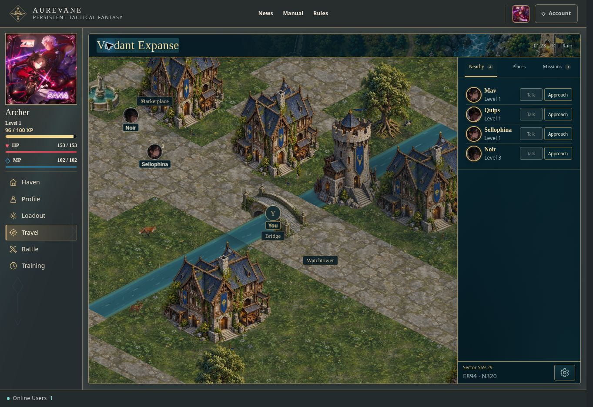

# World movement and arrival responsiveness — October 13

Status: LIVE for testing through PR #893, merge `544e90ba1cb767c9f640fd1d8a43bbe55bafdd99`, Production `dpl_AdXMf59d8oYTT8X3xkFSKBWVdCuz`, READY at `2026-10-14T01:12:32.426Z` (October 13, 21:12:32 Trinidad) at https://aurevane.vercel.app/game/world. This release addresses reproduced causes of the Owner's movement/action reports; human gameplay acceptance remains pending.

## Reproduced causes and resulting behavior

- A saved movement command formerly waited for scene presence, environment settings and portrait presentation before returning approval. The compact opt-in movement response now returns the persisted owned route on the database clock through the existing RPC and lean authority read. Legacy callers retain their complete response. The private-filtered current sector travels with the approval so a delayed boundary receipt always has a real origin; the rest of the scene, peers and other presentation hydrate independently; they cannot occupy or abort the command queue or overwrite a newer owned route.
- Repeated distant clicks discarded already approved route prefixes and restarted the600ms preview allowance. Approved common prefixes retain their normal clock; only new/divergent segments use that allowance, and shorter destinations discard obsolete tails.
- Scene hydration starts before loaded terrain runs out. Agreeing approved tails can extend on-time without restarting interpolation. Divergent previews, shorter targets, local stops and late terrain retain their existing visual position. Canonical receipts still decide movement; unknown cells are never invented.
- Own200ms versions repeatedly cancelled400ms peer reads, starving updates during sustained movement. Already authorized replies can survive newer own versions in the identical retained authorized scene. Character/visibility/geometry/atlas changes still cancel them; receive registration and exact server request-version checks remain unchanged. Identical complete scene content retains references and avoids terrain/nav reindexing. Slow scene replies do not rewind newer peer movement/eligibility.
- Arrival actions formerly used the last persisted tile, so they lagged the approved walking clock. Tile-boundary display updates now change controls without rendering the whole scene on every animation frame. Starting Approach shows the same primary footprint as Attack; protected or out-of-range Attack stays disabled. Disabled Talk for players and Interact for AIs appears on its left; neither future interaction is enabled. A completed approach to a moving target can become Approach again.
- Attacks formerly performed two full world presentations and eight sequential skill-content reads for two four-skill builds. Encounter preparation now reads lean authority, batches existing content resolution and overlaps independent policy reads. A validated battle ID returns immediately after canonical encounter creation. The controller applies it as a committed encounter event to its latest owned receipt, so concurrent scene hydration cannot discard the redirect as an older movement version. Legacy API callers still receive a complete World response. Attack drops unsent walk/auto-path jobs while preserving in-flight writes, explicit Stop and earlier actions. Its visual preview holds at the exact current point until the outcome; ordinary pending receipts still update approval clocks without restarting that preview, and blocking/battle authority still wins. Due owned steps settle through the existing tick/commit authority before range checks; stale requests, training/battle/spectating blocks, range, target/build versions and atomic creation remain enforced.
- Restored clocks use the real captured performance origin. More-than8000ms overdue receipts obey the existing one-step lag allowance and40-step catch-up bound. Blocking/battle authority overrides superseded previews, including newer blocking reads with an unchanged World version. Narrowed scenes trim unsupplied future terrain while preserving the exact current visual point; older scene reads cannot withdraw terrain/roads required by a newer loaded approved route. Hydration during backward, turning and partial corrections retains the actual geometric remainder and authored speed. Omitted-origin receipts freeze safely instead of relocating to zero.
- Nearby portraits use original image sources in36px slots with4px vertical padding, fixed primary-action width and horizontal actions. Coarse touch controls remain at least44px; narrow panels preserve full names by wrapping the action pair onto a second row. Visible identity names are bounded to two lines, while full text remains in the DOM for screen readers and in the hover title. Isola naming,35% zoom, ambient effects and existing sharp identity rendering remain intact.
- Disabled native and ARIA-disabled controls now retain the shared stone-arrow cursor, including their child elements, instead of falling back to module/native cursors. Enabled actions retain the stone hand; disabled legality and future Talk/Interact behavior are unchanged. The disposable protected-attack flow asserts both disabled cursors through computed CSS.

## Verification contract

Focused regressions have been observed failing before implementation, including deferred presentation, repeated approved routes, receipt phase, slow authorized peer replies, scene-reference identity/privacy, pending-movement hydration races, overdue restore, stale peer hydration and protected/AI action controls. Independent early review found and prompted fixes for pending-refresh rewinds, zero-origin restore, overdue approval, blocked superseded receipts and latched completed approaches.

The new native disposable two-account flow exercises36px density, delayed scene presentation, fixed Approach/Attack dimensions, disabled Talk and protected Attack, followed by legal canonical encounter creation. Existing desktop/mobile geometry, routing, privacy, held input, ambient motion, globe and full browser flows remain required.

Full local quality checks pass on the final source with5,318 Vitest tests plus seven Node checks, formatting/lint/eight-package types and production build. Independent review reruns248 tests across13 files and a final bounded follow-up verifies91 tests across3 files, finding no remaining Critical/Important issue in the pending-attack hold, queue priority and movement guards. All seven exact-head workflows pass; the release receipt and rendered measurements are recorded below. No database migration, schema change, auth bypass or deployment-configuration change is included. Git automatic deployments remain disabled; the existing Owner authorization covers manual release for testing after gates. Current healthy rollback target is #889 deployment `dpl_GTouFPy3rG8cTtWfsPjPbJWZWDHW`.

Human visual/gameplay acceptance, zero-network-latency and hosted100-player performance are not claimed. The600ms unconfirmed prediction cap and minimum200ms authored tile timing remain enforced.

## First native pass and density correction

The first exact-head candidate `19cccbe162008b2decae22b78ff542690846a962` passed CI (31 pgTAP assertions and5,318 Vitest plus seven Node checks), UI layout review, Skill Engine, Essence Build and Shared Build Snapshots. Living Atlas run `38480178764` completed46 enabled cases but failed one non-vacuous Nearby density assertion: the long-name fixture rendered79.09375px instead of the65px maximum. The new delayed-presentation/protected-and-legal attack/disabled-cursor flow passed in14.2s. The full Responsive browser run remains in progress and is not cancelled.

The density correction bounds visible names to two lines, retaining the complete DOM name and hover title; the existing portrait, action and touch dimensions remain. The same65px regression stays enforced and also verifies full text/title. Independent review finds no blocker; fresh native density and responsive gates are required. The local execution workspace disconnected after publication of the first candidate, so no post-correction local-check claim is made. Publication and verification of the correction are pending. No release has occurred.

The follow-up test assertion initially read a peer name from the owned WorldView fixture; CI rejected it with TS2339 before gameplay checks. The corrected assertion reads the server-projected nearby player name. The execution workspace is restored, and full local verification is rerunning before publication. Neither failing candidate has been released.

After recovery, the corrected source passes a fresh complete `pnpm check`:5,318 Vitest tests plus seven Node checks, formatting/lint/eight-package types and production build. Nearby/workspace expectations explicitly retain the full name/title; independent final review reruns15 tests across2 files and finds no Critical/Important issue. The failing b6f2c64 candidate’s entire Browser smoke workflow has completed at its existing type-check failure; it was not cancelled. Fresh complete exact-head gates remain required on the corrected publication.

## Full browser delayed-response cleanup correction

Candidate `31a21699993526c1d86c955cddfe0a463143cad9` passes exact-head CI, Living Atlas (47 enabled cases), UI layout review, Skill Engine, Essence Build and Shared Build Snapshots. Its complete Responsive Browser smoke run `38483884674` reveals a test-harness race: the new arrival case removes its request handler before awaiting the900ms delayed responses, and Playwright releases those in-flight routes before their fulfillment (`Route is already handled!`). The run is allowed to finish; no workflow is cancelled or narrowed. The older candidate's full Browser run `38480179309` also finishes naturally, with344 passing cases and one density failure. Neither candidate is released.

The corrected fixture stops scheduling new delays, drains every held response before removing only its own named handler, and propagates failed responses. The same protected/illegal Attack, disabled themed cursor, exact arrival, fixed button footprint and legal canonical encounter assertions remain. A direct reproduction using the installed Playwright1.62 server Route class fails when the handler is removed first and passes when fulfillment drains first; independent review confirms the ownership cause and finds no blocker in the correction. The local Chromium download returns an invalid empty archive, so no local native-browser success is claimed. Fresh complete native gates are required on the corrected publication. No product behavior, workflow, migration or deployment configuration is changed by this harness correction.

## Final exact-source verification and release

Tested head: `e5649afb3d6a3a77fa3a6c49da7afd26f72aa7b4`; tree: `9df659509a19caf5e9f23f6265ab9f7c64bf4d07`. The final fresh full local quality gate passes5,318 Vitest plus seven Node checks, formatting/lint/types and production build. Independent review confirms the fixture drains all held responses, removes only its own handler, preserves every arrival/action/cursor assertion and propagates failures. The previously failing arrival case passes in both Atlas and the complete Browser suite.

| Workflow | Exact-head run | Result |
| --- | --- | --- |
| CI | 38488884024 | Success;31 pgTAP,5,318 Vitest, seven Node checks and build |
| Living Atlas browser | 38488883899 | Success;47 passed,79 skipped; arrival case10.3s |
| Full Responsive Browser smoke | 38488883948 | Success;345 Chromium passed,264 skipped;10 Edge passed, two skipped |
| UI layout review | 38488883942 | Success;110 cases plus supporting checks |
| Skill Engine | 38488883976 | Success |
| Essence Build | 38488883943 | Success |
| Shared Build Snapshots | 38488883956 | Success |

Fresh `main` remains `e59a01f9bb744d2ca35fcbf761058f1adfc70997` before merging PR #893. Merge `544e90ba1cb767c9f640fd1d8a43bbe55bafdd99` has exactly the tested tree. Manual Production deployment `dpl_AdXMf59d8oYTT8X3xkFSKBWVdCuz` pins that merge, is READY at `2026-10-14T01:12:32.426Z`, and the canonical alias independently resolves to that deployment/commit. No additional promotion, migration or configuration change is needed. Public home returns200; unauthenticated World redirects to the home page with200. Signed-in World loads correctly.

Atlas artifact `11860554997` (`living-atlas-evidence`) is20,393,930 bytes and its downloaded SHA-256 matches `106c97a085a26088ffc7fb74b8dd631db6f2b42bbbd6f9cb4c6f4169334246e6`. The current actual two-account CI movement delivery is630ms with fallback polling blocked. The synthetic101-player mobile scene at DPR2.625 measures render p9510ms after240 frames; its initial60-frame baseline is57ms. These are local/native CI measurements, not hosted100-player evidence or a promise of zero latency.

## Bounded signed-in Production checks

- Start: Archer at Sector S69-29, E894/N320; HP153/153, MP102/102, XP96/100; local view,100% zoom, zoom lock off and ambient animation on.
- Two six-tile outbound clicks reach Sector S70-29, E900/N320 across the edge, then return exactly to the start. Outbound samples and the warm return show no opposite-direction camera movement. Warm samples are retained in [live-motion-samples.json](2026-10-13-world-instant-actions-assets/live-motion-samples.json). The first outbound series visibly eases near the three-tile preview boundary before approval; it does not reverse. The warm outbound/return progress through that boundary. These bounded DOM camera samples do not establish uninterrupted token/network timing under arbitrary network conditions.
- Nearby renders36px original-source images, including400px custom sources and96px defaults. Three measured rows are45px and the fourth is40px. Disabled Talk buttons resolve to `stone-arrow.png` with hotspot6,3; names retain their complete text/title. Future Talk/Interact stays disabled. No live attack or message is sent to another player.
- Settings allow35% and140% zoom, then restore100%; zoom lock remains off and ambient remains on. Clicking outside closes Settings without moving the character. Isola, Known Lands, sector ordering and main-town selection remain; globe weather is hidden. Return to local view and all resources/position/preferences are restored.
- The identity surface is native847×750 at integral(204,132), avoiding CSS resampling. Live rendered indicators include rain88 particles, one passing cloud,15 animated water cells and three wildlife instances, two walking in the sampled frame. The existing gray identity cue remains when scenery occludes a character.
- The deployment-scoped warning/error/fatal log scan from READY through `2026-10-14T01:22:20.025Z` has no entries. Human acceptance, extended hosted gameplay and hosted multiplayer/load checks remain pending. Server authority,200ms minimum tiles and600ms unconfirmed preview remain.

