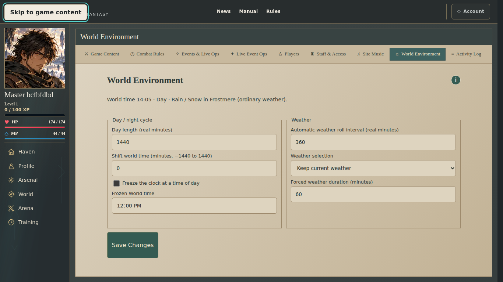

# Master Panel refinements — production testing handoff

October 26, 2026. Owner requested one consolidated candidate, batch verification and one compatible production release.

## Release identity

- Tested head: `8d721fd624d7f99c3679362e83cdd803029966f8` — [PR #981](https://github.com/ZeiJM/Aurevane/pull/981).
- Tested and merged tree: `9cb0b4763809586239e3af37e37e6791f4bf98eb`.
- Production merge: `68fdfd654885466f09cce5ca4c4e571308c43858`.
- New deployment: `dpl_HdrJfZxeE5WZaszSfeu6vhRZyBLA`, canonical <https://aurevane.vercel.app>. Build logs confirm checkout `68fdfd6`; metadata and canonical lookup agree.
- Previous baseline: `a759c6ea651a8e14dff0ec4cdc3bb50f7de1581a`, deployment `dpl_2noMyXV766mtZwJtoGbWY4QXZxaE`. Its unique/git URLs and pinned header/query/cookie requests are retired.
- App READY: `2026-10-26T20:11:07.827Z`. Master testing opened: `2026-10-26T21:23:51.342Z` (17:23:51, America/Port_of_Spain).
- Git automatic deployments remain disabled. One production deployment was created; no preview.

## Completed verification

All 19 pull-request workflows passed on the exact tested head. These are workflows, not a count of individual check rows. Supabase Preview was a skipped integration check.

| Native execution                        | Passed | Configured project skips |
| --------------------------------------- | -----: | -----------------------: |
| Repeated Master authoring and authority |     16 |                        0 |
| Full Chromium                           |    376 |                      284 |
| Edge keyboard and Support Actions       |     10 |                        2 |
| Desktop Experience                      |     49 |                       26 |
| Main UI layout cases                    |    110 |                       61 |

Genuine browser200% zoom, actual authoring/publication/gameplay readers, retained pending edits, Staff save/revoke authority, native media playback and automatic-weather expiry executed. Component/browser fixture gates also passed. The Desktop apt-mirror repair changed only dependency download location; timeout, cases and assertions remained unchanged. Earlier cancelled runs are not counted as passes.

Full quality: 13,044 Vitest tests plus seven Node tests, formatting, lint, eight-package types and production build. The separate hosted-data preflight passed on the final code: all 295 actual publications, all 136 distinct learned/equipped Skill references (zero stored exact publication rows for those pins, compatible builtin fallback checked), and the existing two-song music backfill. All current definitions also traverse the actual current and retained descriptor readers. An initial temporary preflight assertion wrongly expected Discipline containers to appear as combat entries; it was corrected to the existing category projection contract. No product source changed.

Actual signed-in hosted smoke reached character selection, Haven, Arsenal and Techniques. Cards have no extra eligibility labels or Discipline source dropdowns. No selections or gameplay commands were changed. The browser log contained extension-origin metadata errors; no application-origin browser error appeared in the bounded read check. This normal-player session does not provide Owner UI acceptance.

## Migration and integrity receipt

Preparation applies the reusable library, role-default and atomic content-commit migrations. A temporary service-only SQL CHECK rejects old incomplete Music writes; its exact physical proof passes old-write rejection/unchanged data, complete save, browser-role denial and cleanup preservation. Independent review approved the regenerated coordinator wrappers and all seven canonical source hashes.

Only the Master hold was activated before preparation/build. After the new app became canonical READY, six routing rules were activated and ten HTTP checks passed: current document/new-header/new JavaScript200; retired unique/git/header/query/cookie503 with obsolete-cookie clearing; Master page/API503.

Verified retirement/drain start: `2026-10-26T20:13:50.193Z`. After-app not before `2026-10-26T20:27:40.193Z` (800 seconds plus 30 seconds of margin). No per-function extended duration is configured. Master hold remains through after-app/postflight; only that hold is removed afterward. Five retired-deployment guards remain.

Postflight result: PASS. All 25data-set counts/full-row hashes are unchanged; all 35domain function owners/ACLs/normalized full definitions match after exactly 65SQLSTATE replacements. New service-only RPC/private-table ACL and real anon/auth denial checks pass. The prior six elevation rows retain hash `fd4c9670e2eee40e5b9a5b10aad3a6cc`; independent policy 7 is current. Music has two songs and no missing assigned URL. Weekly cleanup is active; temporary Music guard/helper is gone. All seven canonical migration source hashes match. Advisor WARN kinds remain unchanged: three preexisting warnings, with two expected new private-RLS/no-policy informational rows and one singleton-FK informational finding. The bounded deployment error/fatal scan is empty. The initial after-app connector attempt returned an expired requestState; all four canonical entries were confirmed absent before one fresh successful retry. The Master hold is removed; five retirement rules remain as `f710697a-28ab-45e4-bf4f-704e8d35d52b`.

The earlier catalogue-read and focused World SQLSTATE repairs were verified by original source hashes and were not reapplied. The broader audited domain migration changes only65 intentional SQLSTATE assignments in35 functions; genuine PostgreSQL serialization failures, exception messages, authority, locks and mutation contracts remain. Record before/after expected full-definition hashes, owners and ACLs.

Preservation includes deterministic physical row hashes across25 data sets: immutable versions/publication pointers/attribution, all learned/granted/equipped rows, builds, allocations, choices, records/references/media, Staff assignments, timing policies, existing Music settings and World settings. Only the intentionally added song-library/weather-cadence columns are excluded from old-row hashes. Existing elevation rows are compared separately excluding their added model column; the new independent policy is an intentional append.

## Scope and acceptance limits

The delivered scope is tracked in [the37-item acceptance checklist](2026-10-26-master-panel-final-acceptance.md). Compact normal-desktop frames use internal list/editor scrolling; unusually short, mobile or genuinely zoomed windows retain accessible scrolling. Current images/audio live with their content, save/publish is atomic Commit Now, Owner role defaults and the weekly feed are server-protected, weather cadence is independent from override duration, and elevation trials no longer require a100% total.

One requested behavior remains different: visible history is Current/Previous, while deeper immutable published definitions and provenance remain stored for exact-version consumers and captured gameplay. No blanket deletion is claimed. No-op permanent saves prevent new versions/drafts when nothing changes. Owner-signed-in review, physical devices, multiplayer conditions and sustained load remain acceptance work.

Native CI fixture capture from exact head8d721fd6, not hosted Owner-session evidence:

## Remaining panel follow-through

The scoped post-release review found one concrete source gap beyond the known history-retention discrepancy: Archive deletes a current publication and changes record lifecycle, while the feed observed only publication INSERT/UPDATE. Migration `20261026212841_master_activity_content_archive.sql` adds a private, transactional lifecycle trigger. It records one readable actor/title/action on an actual transition to archived, prefers the current title before its publication is removed, falls back to the draft title, ignores actorless system changes and repeated archival, and grants no direct browser/service execution. Existing authoring authority, versions and provenance remain unchanged. Deployment/CI status for this database-only follow-through is recorded in its pull request; it requires no second application deployment. Earlier unrecorded Archive events are not fabricated or backfilled.

The real full-chain RPC regression first failed because the Archive entry was missing, then passed with the trigger. Focused checks cover denied/stale writes, exact one-entry behavior, rollback, immutable-history preservation, draft titles, actorless updates and private helper ACLs. The existing Activity reader/UI accepts the new action string without application changes.

Follow-through verification map: only the private lifecycle-trigger migration and its real database regressions change runtime behavior. Full database package: **364 passed /36files** with two workers; Activity reader/server/page/component adjacency: **7 passed /5files**; focused lifecycle/feed checks: **57 passed /2files** (included in the database total). DB types, scoped lint/formatting and whitespace checks pass; independent review found no Critical/Important issue. The application, combat/World rules, authorization producers and UI source are unchanged from the already verified release. Their full suites are excluded from the local development loop; all configured PR checks remain required before integrating the follow-through. Hosted Archive-event verification will use a rollback-only fixture so no authored record or activity entry is left behind.

ID35 remains explicitly partial. No safe history-GC predicate exists under the current contracts: immutable version/media triggers and FKs protect physical references and provenance; learned/equipped Skills, saved loadouts, battle snapshots, restored drafts and captured Tag presentations retain logical/JSON version pins. The earliest authored Skill version also anchors intrinsic source identity, and monotonic version floors must survive. Removing everything older than Previous or checking only incoming FKs would break arbitrary authored exact-version reads. Current/Previous UI and no-op commits are delivered; physical cleanup needs a compatible durable-archive design and dependency inventory. Protected records remain intact during the Archive-activity repair.

## Remaining Aurevane work, prioritized

1. **World map stability:** reproduce remaining loading stalls, clicks on valid but currently unavailable ground, blocked traversal and direction-change behavior in live play. Keep existing discovery, collision, authoritative timing and approved movement limits. Previously shipped scenery/cache/heartbeat/UI repairs are verification baselines, not unimplemented features.
2. **Neighbour presence and remote motion:** validate arrival, departure, reconnect and delayed-frame motion with multiple real players. [PR #933](https://github.com/ZeiJM/Aurevane/pull/933) is closed unmerged as superseded, not an open implementation item. [Merged PR #970](https://github.com/ZeiJM/Aurevane/pull/970) delivers isolated fixtures and bounded render timings. Its latest exact-head repeat run completed40/40 on October22 with unchanged limits and no retries; that is diagnostic/automated evidence, not proof every reported live movement symptom is resolved.
3. **Rare click-to-move pause:** capture the specific remaining interruption and correlate request/approval timestamps, animation callback lateness and render work. Prior reproduced three-step/arrival issues have shipped fixes; this rare residual symptom remains unverified. Do not guess a smoothing change or call the diagnostic work a production fix.
4. **Measured performance and Owner acceptance:** exercise the new panel's actual edits/reopen/gameplay effect and inspect any recurrence of lag. Measure request duplication, long-tail navigation/render times and concurrent load under [issue #439](https://github.com/ZeiJM/Aurevane/issues/439). The repaired catalogue/conflict/no-op paths have automated and hosted evidence; sustained load and personal responsiveness acceptance remain open.
5. **Finish the remaining P5 world/content slices:** W2 globe/local navigation and destination clarity; W3 contextual NPC conversations/services/quests and authored places; W4 character/power-choice clarity and protected eligibility; Drift rollout and playtest sign-off. [NPC PR #765](https://github.com/ZeiJM/Aurevane/pull/765) still needs dependency reconciliation. [Settlement PR #681](https://github.com/ZeiJM/Aurevane/pull/681) remains draft until matching v02 paintings are produced/reviewed with the geometry. [Creative PR #373](https://github.com/ZeiJM/Aurevane/pull/373) remains a separate unmerged identity/terminology package, not completed runtime work.
6. **Later game roadmap:** parties/invites/co-op quests and battles; expeditions/dungeons/bosses/loot; PvP matchmaking/rankings/seasons/tournaments; expanded Disciplines/Skills/enemies/equipment; friends/guilds/messages; vendors/crafting/trade/economy; nations and larger campaigns; art/audio polish and alpha security/load/exploit gates. Existing solo traversal, duels/spectation, base roster, profiles and presence are foundations already delivered, not missing wholesale systems.

These are remaining-work reporting priorities. This Master release does not close P5 or authorize implementation of those later systems.
